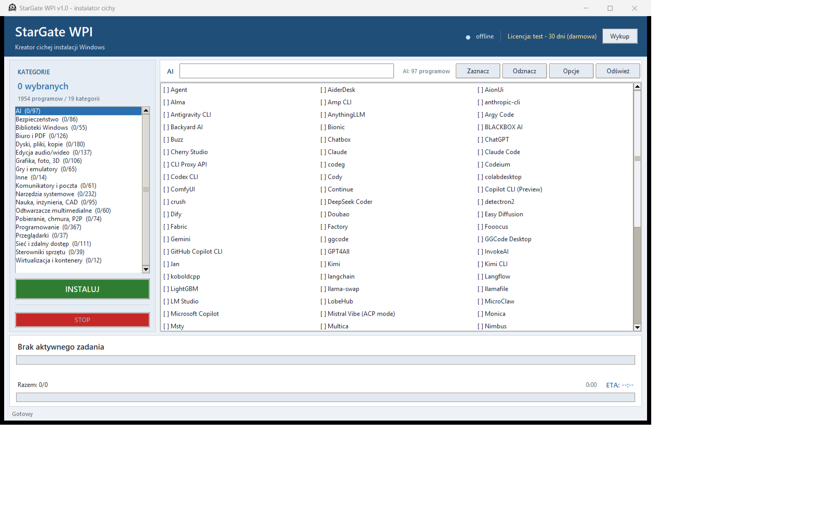

# StarGate WPI

**Kreator cichej instalacji programów Windows**

Zaznacz programy, kliknij INSTALUJ — reszta dzieje się sama. StarGate WPI pobiera najnowsze wersje z oficjalnych źródeł i instaluje je cicho, bez klikania w okna instalatorów.

## Co potrafi

- **1954 programów** w 19 kategoriach (AI, bezpieczeństwo, biuro, grafika, programowanie, narzędzia systemowe i więcej)
- **Zawsze najnowsza wersja** — adresy pobierania aktualizowane automatycznie z oficjalnych stron producenta
- **Cicha instalacja** — bez okien, pytań, pasków postępu. Zaznacz i idź po kawę
- **Cicha deinstalacja** — to samo w drugą stronę
- **Wykrywanie zainstalowanych** — program wie, co już masz
- **Język systemu** — instalator wybiera polski (lub inny język systemu), jeśli program to obsługuje
- **Kategorie**: AI, Bezpieczeństwo, Biblioteki Windows, Biuro i PDF, Dyski/pliki/kopie, Edycja audio/wideo, Grafika/foto/3D, Gry i emulatory, Komunikatory i poczta, Nauka/inżynieria/CAD, Narzędzia systemowe, Odtwarzacze multimedialne, Pobieranie/chmura/P2P, Programowanie, Przeglądarki, Sieć i zdalny dostęp, Sterowniki sprzętu, Wirtualizacja i kontenery, Inne

## StarGate Helpdesk

Zdalny pulpit i pomoc techniczna przez szyfrowany tunel NATS:
- Podgląd i sterowanie ekranem
- Przesyłanie plików
- Przekazywanie dźwięku
- Szyfrowanie end-to-end (AES-256-GCM + ECDSA)
- Bez otwierania portów — działa za NAT-em

## Pobieranie

Pobierz najnowszą wersję z zakładki [Releases](../../releases).

## Licencja

- **30 dni za darmo** — pełna funkcjonalność, bez ograniczeń
- Po 30 dniach: zakup licencji (przycisk **Wykup** w programie)

## Ostrzeżenia

> **Plik nie jest podpisany cyfrowo.** Windows Defender SmartScreen może wyświetlić ostrzeżenie przy pierwszym uruchomieniu. Kliknij "Więcej informacji" → "Uruchom mimo to".

> **Program wymaga uprawnień administratora** do instalacji oprogramowania.

> **Wersja testowa.** Program jest w fazie aktywnego rozwoju i testowania. Niektóre programy mogą się nie zainstalować poprawnie. Zgłaszaj błędy w zakładce [Issues](../../issues).

> **Antywirus może zgłosić fałszywy alarm.** Plik jest kompilowany Nuitką (Python → natywny exe), co niektóre antywirusy traktują jako podejrzane. Jeśli nie ufasz — nie uruchamiaj.

## Wymagania

- Windows 10 / 11 (x64)
- Uprawnienia administratora
- Połączenie z internetem (do pobierania programów)

## Kontakt

Błędy i sugestie: [Issues](../../issues)
